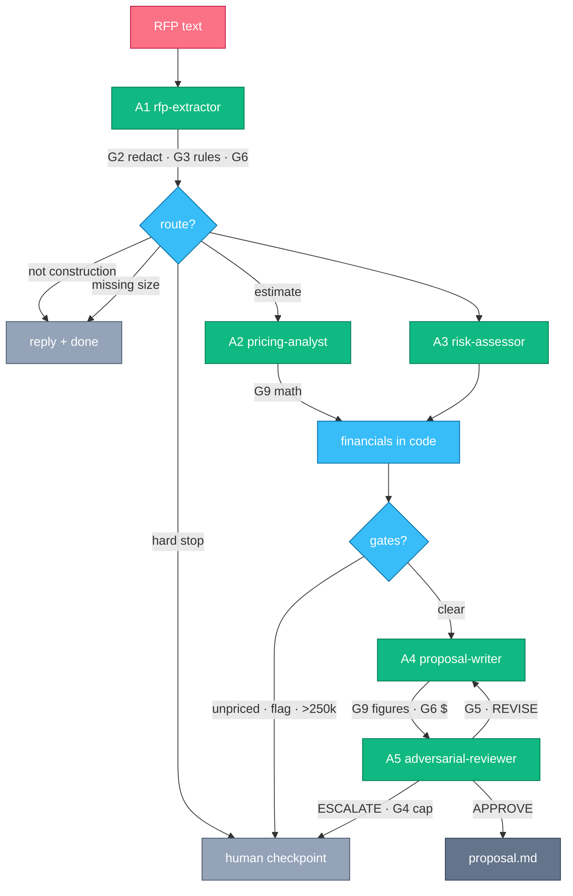

# Design

## The idea

An RFP is prose. A bid is numbers plus a promise. Between them sit judgments (what materials, what risk, what to say)
and arithmetic (what it costs). Agents make the judgments. Code does the arithmetic and checks every number an agent prints.

## Agents

| Agent | Job | Must not |
| --- | --- | --- |
| A1 `rfp-extractor` | List the materials with a quantity, a unit, and where the number came from | Price anything, invent a size |
| A2 `pricing-analyst` | Match each material to a price book item, compute line totals | Invent a price |
| A3 `risk-assessor` | Name the risks with a quote as evidence, pick a contingency rate from 10% to 25%, raise flags | Compute the bid |
| A4 `proposal-writer` | Write the five-section proposal, copying the figures | Change a number, add scope, promise a date |
| A5 `adversarial-reviewer` | Find wrong numbers, invented scope, unfit exclusions, promises, missing sections | Rewrite the proposal |

Each agent is one prompt: a role sentence, three to six rules, a JSON schema, the inputs. Each has its own test suite.

## Code, not agents

- The formula: labor = 60% of materials; overhead = 15% of materials plus labor; contingency = A3's rate of the same; bid = the sum.
- Routing: hard-stop phrases, "not construction", "missing a size" decide the route before any pricing happens.
- Gates after pricing: unknown material, hazard or legal flag, bid above 250,000 USD.
- Checks on agent output (G1 to G9): schema, redaction, hard rules, review loop cap, verdict consistency, grounding, halt file, budget, and the arithmetic.

## The pipeline and its checks

`A1 extract → route → (A2 price ∥ A3 risk) → financials → gates → A4 write ⇄ A5 review.`
Every transition also runs G7 (halt file) and G8 (budget ceiling),
and every agent call runs G1 (schema).

Any punch-out writes a checkpoint file and stops the run with `WAITING_HUMAN`; a human edits the file and the same run resumes.

| Where | Check | What it does |
| --- | --- | --- |
| Every agent call | **G1 schema** | Parses the output as JSON and validates it against `schemas/aN-*.json`. One retry, then `FAILED_SCHEMA`. |
| After A1 | **G6 grounding** | Every quantity A1 states must appear in the raw RFP text. Fail → `FAILED_GROUNDING`. |
| After A1 | **G2 redaction** | Strips personal data from the RFP text and A1's output before any later agent sees them. |
| After A1 | **G3 hard rules** | Hard-stop phrases (asbestos, legal clauses, injection attempts) → punch-out to a human. |
| After A1 | **Router** | `decideRoute`: G3 → `PUNCH_OUT`; not construction → `NO_BID`; missing quantities → `NEEDS_INFO`; else `ESTIMATE`. |
| After A2 | **G9 math** | `verifyPricing` recomputes every line total against the price book. Fail → `FAILED_MATH`. |
| After A2 ∥ A3 | **Gates** | `unpriced-material`, `risk-flag` (hazard or legal), `bid-threshold` (final bid above 250,000 USD). Any hit → punch-out. |
| After A4 | **G9 figures** | `verifyProposalFigures` checks the draft's five figures equal the computed financials. |
| After A4 | **G6 grounding** | Every dollar amount in the proposal must match a computed figure or a priced line. |
| After A5 | **G5 verdict consistency** | Drops `number_mismatch` findings (G9 already guards numbers); an APPROVE with remaining findings becomes REVISE; no findings becomes APPROVE. |
| After A5 | **G4 loop cap** | At most 2 revise rounds; a third REVISE or an ESCALATE → punch-out to a human. |
| Every transition | **G7 halt file** | A `HALT` file in the run directory aborts the run. |
| Every transition | **G8 budget** | Cost or prompt-token totals above `budget.json` → `FAILED_BUDGET`. |

## Why these choices

| Choice | Reason |
| --- | --- |
| Math in code | An agent that adds wrong is caught, retried, then failed. No wrong bid leaves the system |
| A2 and A3 in parallel | Neither needs the other; the audit log shows the overlap |
| Price book | The expected line totals can be computed, so the tests check numbers, not opinions |
| Punch-out that resumes | A human edits one file and the same run continues; the log shows the human step |
| Two low-cost models under test | Every prompt is measured on both; the pipeline pins the better one per agent |

## Fixtures and expected answers

Twelve RFPs: four reference jobs (dental fit-out, flat roof, masonry wall, concrete slab) and eight edge cases
(missing sizes, asbestos, oversized slab, prompt injection, not construction, unknown material, liquidated damages, small repair).
The expected quantities come from written formulas (`fixtures/rfps/derivations.md`) and the price book, not from a reviewer's taste.
The eight edge cases and their expected routes are written by hand.

## Assumptions

- The reviewer is an AI critic; a human enters only when it escalates or a gate hits.
- Every price, client, and RFP is synthetic.
- The final proposal is a file; nothing is sent anywhere.
